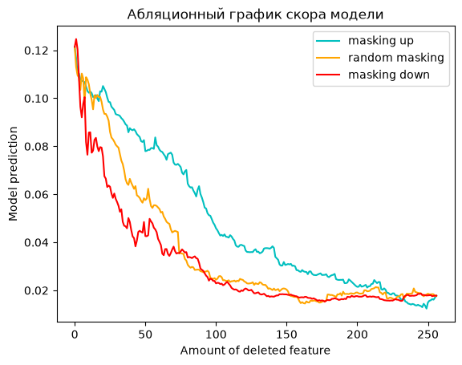
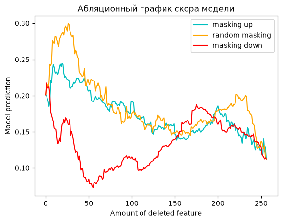

Установка:

`conda create --name TIMXAI'

'conda activate TIMXAI'

'pip install -r requirements.txt'

'mkdir model_files'

В `model_files` распаковывается архив с моделью, дальше работа идет через тестовый ноутбук,
либо самостоятельное использование методов из `xai_methods`.

Backlog:

(X) - где X обозначает приоритет выполнения.

* Оценка на разных моделях - Не выполнено
    Необходимо сделать сравнительный анализ
    на разных квантилях длины транзакций клиентов,
    посчитать различные метрики - посмотреть согласованность между auc и выделением признаков.
    Гипотеза: Модель с лучшим скором должна лучше
    объяснять данные.

Методы нахождения вкладов атрибуций:
* (1) Реализовать Integrated Gradients(IG) - Выполнено

    Для валидации метода была проведена проверка на клиентах с числом транзакций из
    приблизительно 5/95/50 квантилей.

* (2) Ускорить IG для того, чтобы быстрее производить эксперименты - Выполнено.

    Показана эквивалетность двух методов в ранжировании магнитуды вкладов признаков, при помощи метода Пирсона.

(Метрики/ Методы) оценки Вкладов:

* (1) Распределение вкладов признаков(оценки с учетом длины транзакций) - Не выполнено

* (1) Доверие объяснением - Частично выполнено

    * Было показано что текущий подход c маскированием по магнитуде, некоторых клиентов объясняет хорошо:

    

    А некоторых очень плохо:

    

    * (Наблюдение) В литературе которую я читал
    [\[1\]](arxiv.org/pdf/2506.05035), [\[2\]](arxiv.org/pdf/2107.14317), есть заметный паттерн:

        1. Ведение новой метрики

        2. Оценка на ней своих и чужих методов, с игнорированием чужих методов оценки.

    Это приводит к сложности оценки согласованности методов.

* (1) Маскирование - Невыполнено
    Необходимо рассмотреть различные бейзланы,
    пока что имплементирован лишь нулевой бейзлайн.

    Также стоит проверить на bert архитектуре дискретные
    виды маскирования, их можно интерпретировать с помощью
    IG при помощи GEFA, которая полностью удоволетворяет
    всем аксиомам IG.

* (2) CPP/CPD - Выполнено
    Написать про cpd/cpp связь с timing, и попытку объяснить signed bias

* (1) AUC Drop - Не выполнено

    Пока не реализован, но необходим, для оценки падения распознования
    классов для заданного набора клиентов.

    Метрика необходима как дополнительный способ оценки вкладов признаков,

    Также это может быть полезно для оценки прироста потери качества
    при удалении следущего набора признаков.

* (1) Masked AUC - Выполнено

    Оценка падения уверенности модели на конкретном клиенте.

* (1) Маскирование признаков - Выполнено

    Реализованно три вида маскирования,
    по росту магнитуды вклада(DownMasking) и по убыванию соответственно(UpMasking).

    Также в качестве baseline используется рандомное маскирование признаков(RandomMasking).

    (!!! Сейчас резко осознал, что можно делать не только по магнитуде, но и без неё, это потом добавлю)

    Желаемое/Недосягаемое поведение: любая метрика F удовл неравенству:
        $$ F(\text{UpMasking}) \leq F(\text{RandomMasking}) \leq F(\text{DownMasking})$$

    Что означает, что метод получения вкладов признаков, по которому мы маскируем, способен корректно учитывать временные зависимости признаков.

* (2) Перестановочные проверки признаков - В процессе

    В силу устройства датасета, было сделано предположение, что очередная транзакция не обязательно зависима от предыдущего набора.

    Поэтому возможно делать перестановки транзакций, для клиента в временном ряду,
    что не должно ухудшать качество.

    Тесты показали, что качество модели резко снизилось для всех клиентов по метрике Masked AUC

    До перемешивания(Masked AUC):

    

    После перемешивания(Masked AUC):

    
